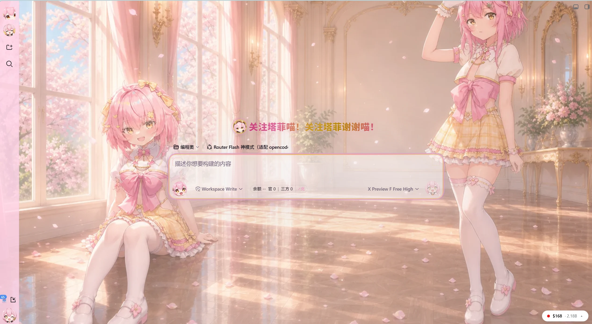
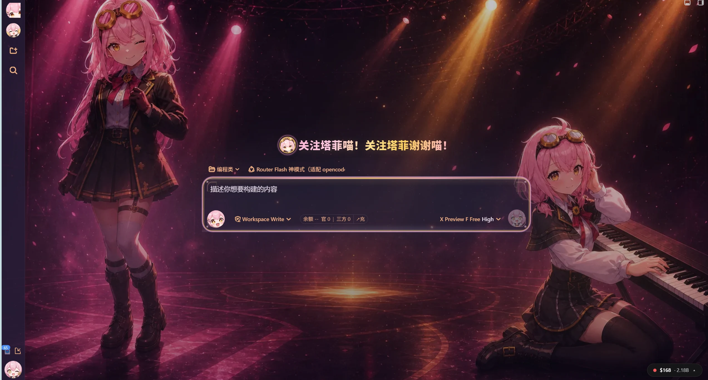

# Taffy Live Atelier / 塔菲直播工房

[](https://github.com/lengzhanbao/dsh-taffy-theme/actions/workflows/ci.yml)
[](https://awesome-dsh-plugin.com)

粉金亚克力 **DSH Web 主题** — 浅色花房 / 深色舞台立绘、粉金对话框与金粉花纹、塔菲 Q 版侧栏，以及可选的 **Taffy 塔菲** Agent 预设。

| | |
| --- | --- |
| Package | `@dsh-external/dsh-taffy-theme` |
| Version | `0.1.9` |
| Platform | DSH **Web** profile 或 **Desktop** profile —— 见下方「选对 profile」 |
| Requires | `engines.dsh`：`>=0.1.6-alpha.1 <0.2.0 \|\| >=0.2.1-rc.2 <0.3.0` |

## 选对 profile

**桌面版与浏览器版跑的是两个不同的 profile。装错地方就不会生效**（本机实测）：

| 你在用 | profile 名 | 数据目录 |
| --- | --- | --- |
| **DSH Desktop 应用** | `desktop` | 例如 `E:\DeepSeekHarness` |
| 浏览器里的 DSH Web（`dsh web`） | `web` | 例如 `C:\Users\SYH\.dsh` |

> ⚠️ **验证状态**：`web` profile 已在 DSH 0.2.1-rc.2 上完成安装、启动与浏览器端验收（见 `docs/COMPAT-0.2.x-2026-10-19.md`）。
> **`desktop` profile 尚未完成实机安装验证**（见 `docs/DESKTOP-AUDIT-2026-10-19.md`）—— 桌面版的目标 profile 是 `desktop`，但本插件还没有在真实桌面运行时上跑过。

## 下载即用

**普通用户只需一条命令，无需克隆仓库或本地构建。**

```bash
# 浏览器版 DSH Web
dsh plugin --profile web add https://github.com/lengzhanbao/dsh-taffy-theme/releases/download/v0.1.9/dsh-external-dsh-taffy-theme-0.1.9.tgz

# 桌面版 DSH Desktop（目标 profile 是 desktop；本插件在该环境尚未验证）
dsh plugin --profile desktop add https://github.com/lengzhanbao/dsh-taffy-theme/releases/download/v0.1.9/dsh-external-dsh-taffy-theme-0.1.9.tgz
```

然后：**设置 → 通用 → Taffy 模式** 打开总开关，再 **硬刷新**（`Ctrl+F5`；桌面版请完全重启应用）。

| 文档 | 说明 |
| --- | --- |
| [安装指南（中文）](docs/install.zh.md) | 环境要求、自检清单、FAQ、升级/卸载 |
| [Install guide (EN)](docs/install.en.md) | Same for English |
| [使用说明](docs/usage.zh.md) | 透明度、预设、素材声明 |
| [CHANGELOG](CHANGELOG.md) | 版本变更 |

## 截图

| 浅色 Light | 深色 Dark |
| --- | --- |
|  |  |

## 简介

**Taffy Live Atelier** 为 [DeepSeek Harness](https://github.com/deepseek-ai/deepseek-harness) Web 提供虚拟直播工房式界面：浅色花房与深色霓虹舞台、粉金亚克力对话框、塔菲 Q 版侧栏。资源全部本地打包，不依赖 CDN；**只改外观**，不影响对话逻辑与其他插件。

- 架构思路参考 [maid-atelier](https://github.com/Small-tailqwq/dsh-deep-whale/tree/main/maid-atelier)，**未复制**其代码与资产
- `--dsw-*` token 限定在 DSH 列容器内；亚克力 **opt-in**，降低误伤第三方插件风险

### 近期视觉（0.1.7–0.1.9）

- **粉金金粉花纹**：输入框 / 侧栏 / 「新会话」「设置」板框角饰与尘条（不撑大边框）
- **Whale 式侧栏折叠**：展开/收起为粉金边框 + 原生 panel SVG（不再用裁切头像）
- **可读性默认抬高**：纱幕 / 亚克力 / 面板更实；兼容 DSH `0.1.6-alpha`（`dsh-client-ui-renderer`）

## 稳定性说明

| 面向 | 说明 |
| --- | --- |
| 普通用户 | Release `.tgz` 安装；发版前 `verify:pack` + 本地 profile 冒烟 |
| 已知边界 | 依赖 DSH Web DOM；DSH 大版本升级后请装最新 Release；更新后需**重启** `dsh web` |
| 维护者 | `npm test` + `verify:*` 门禁；见 [release-checklist.md](docs/release-checklist.md) |

## 卸载

```bash
# 换成你安装时用的 profile（web 或 desktop）
dsh plugin --profile web remove @dsh-external/dsh-taffy-theme
```

刷新页面后界面恢复默认。

## 开发者

```powershell
# 本地 link 到 3080（仅开发）
npm run install:dev
dsh web

# 生产式 pack 冒烟（发版前推荐）
npm run install:release
```

详见 [environment-baseline.md](docs/environment-baseline.md)、[rollback.md](docs/rollback.md)。

**切勿**手改 `profiles/web/package.json`（UTF-8 BOM 会导致 DSH 无法启动）。

## 素材与授权

- **源代码**：[MIT](LICENSE)
- **角色图像**：非官方同人 fan skin；详见 [NOTICE.md](NOTICE.md)

## English

Candy-pink acrylic theme for DSH Web: light conservatory, dark neon stage, gold-pink chat frame with filigree, and Taffy character overlays. Sidebar collapse uses a whale-style gold-rim native SVG (no cropped face sticker). Install with the command above, then see [docs/install.en.md](docs/install.en.md) and [docs/usage.en.md](docs/usage.en.md).
